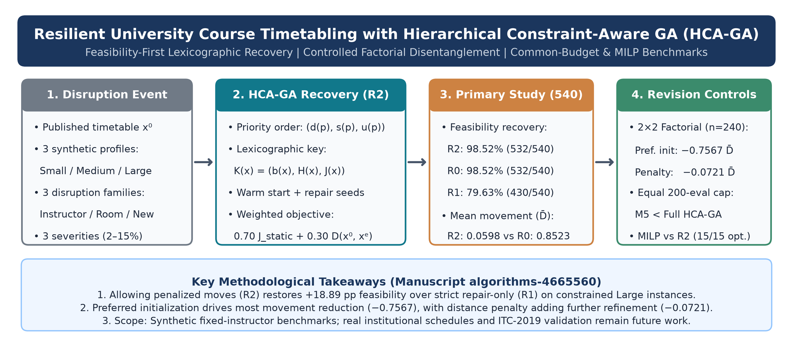

# Supplementary Materials — Manuscript `algorithms-4665560`

**Title:** Resilient University Course Timetabling with a Hierarchical Constraint Aware Genetic Algorithm  
**Authors:** Saman Tarighpeyma Aghbolagh, Yousef Farhang\*, and Mehmet Akif Cifci  
**Journal:** *Algorithms* (MDPI)

---

## Repository Contents

| Path | Description |
| :--- | :--- |
| [`Supplementary_Materials_algorithms-4665560.pdf`](Supplementary_Materials_algorithms-4665560.pdf) | Complete Supplementary Materials PDF (Sections S1–S6: mathematical notation & objective component definitions, formal algorithmic specifications & MILP model, experimental seed & environment registry, embedded Figures S1–S5, reviewer-response traceability matrix, and reproducibility checklist). |
| [`Supplementary_Materials_algorithms-4665560.docx`](Supplementary_Materials_algorithms-4665560.docx) | Editable Word version of the Supplementary Materials document. |
| [`tables/Supplementary_Tables_algorithms-4665560.xlsx`](tables/Supplementary_Tables_algorithms-4665560.xlsx) | Formatted multi-sheet Excel workbook containing all 13 manuscript tables (`Table_01`–`Table_13`), `Table_S1` (reproducibility metadata), and an Overview index. |
| [`tables/csv/`](tables/csv/) | 14 UTF-8 machine-readable CSV files (`Table_01_hard_constraints.csv` through `Table_13_category_costs.csv`, plus `Table_S1_reproducibility_manifest.csv`). |
| [`figures/`](figures/) | Original manuscript figures (`Figure_1`–`Figure_3`, PNG), four new supplementary figures (`Figure_S1`–`Figure_S4`, 300 DPI PNG + vector SVG) covering the revision experiments (Tables 8–13), and the Graphical Abstract (`Graphical_Abstract_HCA_GA`, PNG + SVG). |
| [`references.bib`](references.bib) | Complete BibTeX bibliography of all 34 verified references cited in the revised manuscript. |
| [`experiment_config.json`](experiment_config.json) | Machine-readable JSON specification of synthetic profiles, HCA-GA hyperparameters, revision controls, random seeds, and Appendix B SHA-256 digests. |
| [`MANIFEST.json`](MANIFEST.json) | SHA-256 checksums and file sizes for every file in this repository. |

---

## Scope & Reproducibility Notes

- **Experimental Scope:** As stated in Sections 2.3, 5.1, 6.8, and 7 of the revised manuscript, all computational experiments use controlled synthetic fixed-instructor/program-conflict instances (`Small`, `Medium`, and `Large` profiles) and replayable single-event disruptions. These synthetic instances are not relabeled as ITC-2019 benchmark data; full ITC-2019 and authorized institutional timetable evaluations remain future work.
- **Original Archive Verification (Appendix B):** The verified record counts and SHA-256 digests for the original `icebm-resilient-timetabling-phase7` experimental records (source commit `6b59879e5ea6061abb403f9cf788d560da3ae911`) are documented in [`tables/csv/Table_S1_reproducibility_manifest.csv`](tables/csv/Table_S1_reproducibility_manifest.csv) and [`experiment_config.json`](experiment_config.json).
